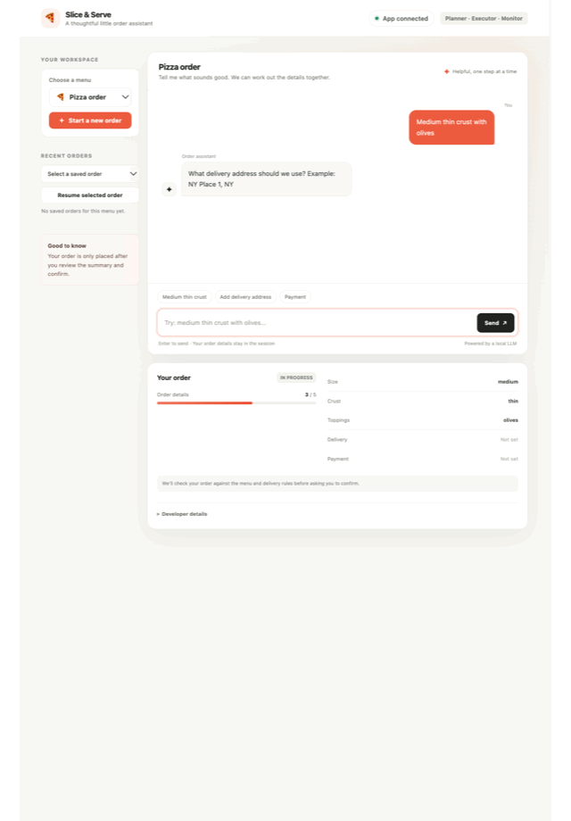
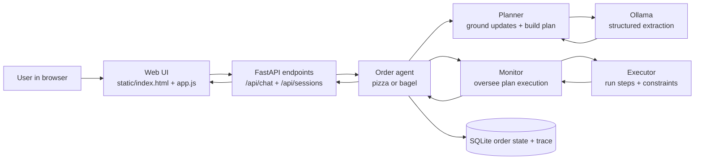
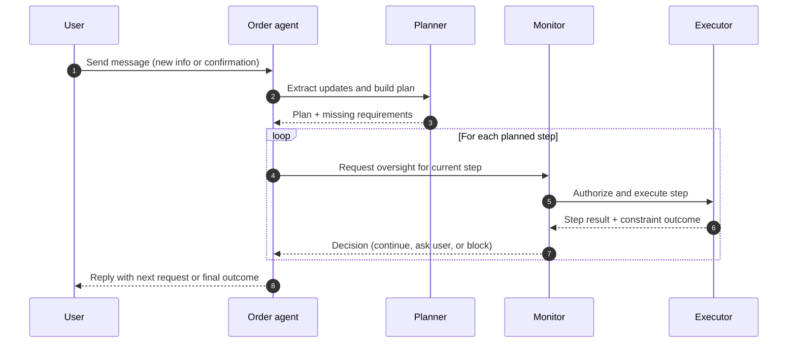
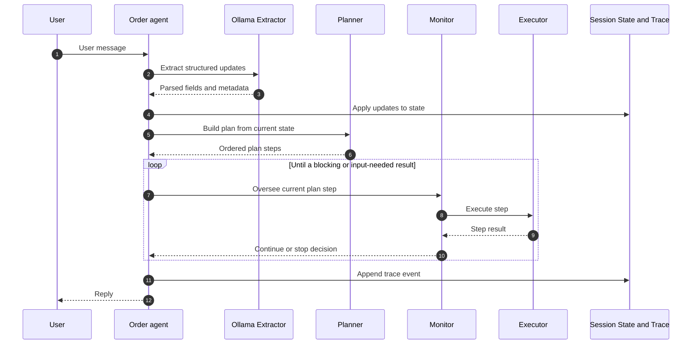
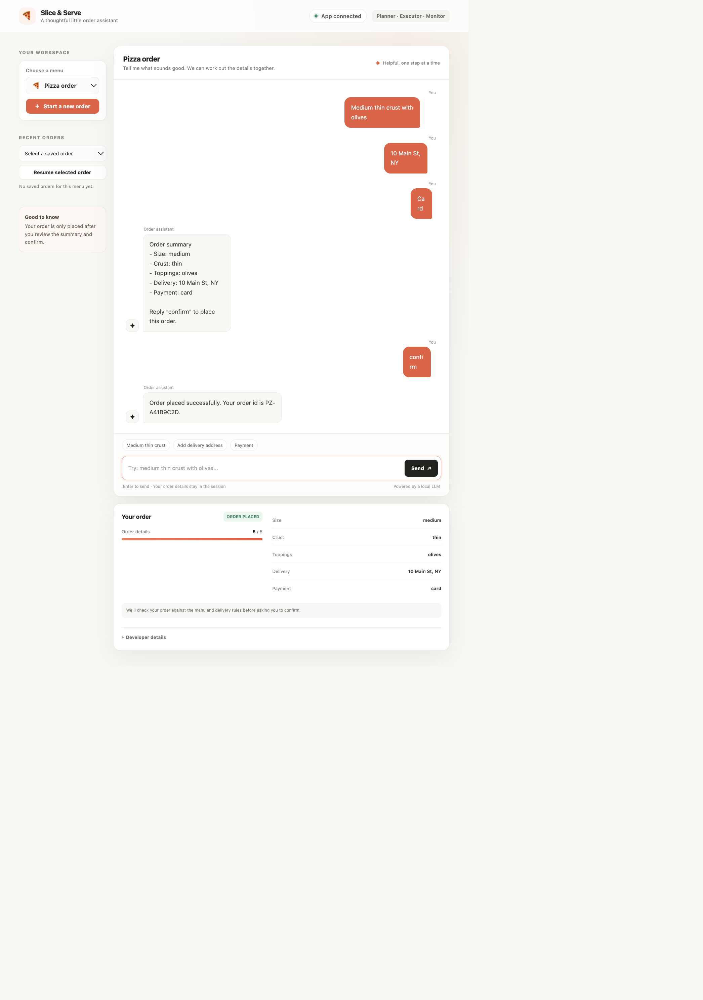

# Slice & Serve — AI Food Ordering Assistant

[](./assets/pizza-order-final.png)

Slice & Serve is a portfolio project exploring how an AI assistant can collect and validate food orders through a modern chat interface. It supports pizza and bagel flows, lets users save and resume demo orders, and exposes a developer trace to make the agent's decisions easier to inspect.

Orders move through explicit planning, execution, and monitoring steps. Ollama proposes structured updates; deterministic validation checks them against the user's message before they can change the order. The app applies demo constraints and requires confirmation before simulating order placement. If the model is unavailable or times out, a limited deterministic parser handles supported requests.

## Project highlights

- LLM-assisted structured extraction with evidence checks to reject unsupported updates.
- Bounded model timeouts and deterministic fallback for supported inputs.
- Planner–Executor–Monitor flow with order constraints, user confirmation, and inspectable traces.
- SQLite persistence with browser-scoped demo sessions, resume, and delete controls.
- Stop and replace behavior for changing intent during a turn.
- Responsive interface, Docker setup, offline tests, and CI across supported Python versions.

This is a demo application, not a live ordering or payment service. Payment and order placement are simulated.

## Architecture

The API coordinates two order flows. Each flow uses the same general pattern: extract candidate fields, validate them, build a plan, run monitored steps, then persist the resulting state and trace.



**Runtime components and control flow.**

## Request lifecycle

The sequence below highlights responsibility handoffs during a single user turn.



**One turn through planning, execution, and monitoring.**



**Single-turn request lifecycle.**

### Key modules

- `webapp.py`: FastAPI routes, browser-owner cookie, request logging, and turn cancellation.
- `agents.py`: pizza and bagel turn orchestration.
- `planner.py`: field extraction, deterministic fallback, and next-step planning.
- `grounding.py`: evidence checks on model-proposed updates.
- `execution.py`: order constraints and monitored execution steps.
- `ollama_client.py`: bounded structured-extraction requests to Ollama.
- `session_store.py`: SQLite persistence for session state and traces.
- `app_models.py`: order state and API/extraction schemas.
- `static/`: responsive chat interface and order/debug panels.

## Run locally

1. Python 3.11 or 3.12
2. [uv](https://github.com/astral-sh/uv)
3. [Ollama](https://ollama.com/) installed and running locally
4. An Ollama model pulled locally (default extraction model in this project: `llama3.2`)

Install dependencies from the project directory:

```bash
uv sync --extra dev
```

The `dev` extra installs `pytest` alongside the application dependencies declared in `pyproject.toml`.

> **NOTE:** On Windows, Smart App Control may block part of the Python or test toolchain. If that happens, review Microsoft's [Smart App Control guidance](https://support.microsoft.com/en-gb/windows/smart-app-control-has-blocked-part-of-this-app-0729fff1-48bf-4b25-aa97-632fe55ccca2) before changing security settings.

If you need to pull the default model:

```bash
ollama pull llama3.2
```

## Tests and evaluation

Run the unit tests without requiring a live Ollama endpoint:

```bash
uv run pytest -q -m "not integration"
```

Tests marked `integration` require Ollama to be running with the configured extraction model available.

The offline extraction examples use a small checked-in evaluation set and do not call Ollama:

```bash
uv run pytest -q tests/test_extraction_evals.py
```

To evaluate the configured Ollama model against those examples (uses model tokens and may take a few minutes):

```bash
uv run python scripts/evaluate_extraction.py
```

The report includes exact-match and field-match scores plus mean latency. It exits with a non-zero status if any case does not match exactly.

Start the app:

```bash
uv run uvicorn main:app --reload --port 8000
```

Open:

- http://127.0.0.1:8000

## Configuration

The following environment variables are optional:

- `OLLAMA_HOST` (default: `http://127.0.0.1:11434`)
- `OLLAMA_EXTRACT_MODEL` (default: `llama3.2`)
- `OLLAMA_TIMEOUT_SECONDS` (default: `8`; clamped to 1–30 seconds)
- `OLLAMA_EXTRACT_RETRIES` (default: `0`; clamped to 0–2 retries)
- `OLLAMA_MODEL` (legacy fallback alias for extraction model)
- `DATABASE_PATH` (default: `data/orders.sqlite3`)
- `PORT` (default: `8000`)

Example:

```bash
set OLLAMA_EXTRACT_MODEL=llama3.2
set OLLAMA_TIMEOUT_SECONDS=8
uv run uvicorn main:app --reload --port 8000
```

## Saved sessions and demo data

Order state and debug traces are stored in SQLite and remain available after restarting the app. A trace includes the user's message, raw/parsed extraction metadata, interpreted updates, state, and execution events. The database also stores the demo cookie-signing secret. Messages and current order fields are sent to the configured Ollama endpoint for extraction, so review that endpoint's data-handling terms before using it. The browser stores a signed, HTTP-only owner cookie for up to 30 days; it contains no order data. Use **Recent orders** to resume or delete an individual saved order.

**This is demo isolation, not authentication.** Anyone using the same browser profile shares its owner cookie. A copied cookie grants access to that demo owner's orders, and the local database is not encrypted. Do not enter real payment details, passwords, or sensitive personal information.

To clear one order, select it in **Recent orders** and choose **Delete selected order**. To clear all local orders and rotate the demo cookie secret, stop the app and remove the database file:

```bash
rm data/orders.sqlite3
```

If you set `DATABASE_PATH`, remove that file instead. For Docker, remove the persistent volume after stopping the container:

```bash
docker volume rm pizza-orders
```

Clearing browser cookies signs that browser out of its demo owner, but does not delete database rows. Deleting the SQLite file or Docker volume removes saved session state and traces.

## Docker

Build and run the app with a persistent Docker volume for the SQLite database:

```bash
docker build -t pizza-order-agent .
docker volume create pizza-orders
docker run --rm -p 8000:8000 \
  -e OLLAMA_HOST=http://host.docker.internal:11434 \
  -v pizza-orders:/app/data \
  pizza-order-agent
```

On macOS and Windows, `host.docker.internal` lets the container reach an Ollama server running on the host. On Linux, configure `OLLAMA_HOST` to a host address reachable from the container. Pull the configured model into that Ollama server first.

## Hosting

To deploy, push this repository to GitHub and connect it to a hosting service that supports Dockerfiles and persistent disks/volumes:

1. Select Dockerfile-based deployment and expose the service's assigned HTTP port (the container reads `PORT`, defaulting to `8000`).
2. Set `OLLAMA_HOST` to an Ollama API endpoint reachable from the deployed service. A local `127.0.0.1` address will not work unless Ollama runs in the same network/container.
3. Set `OLLAMA_EXTRACT_MODEL` to a model available on that Ollama endpoint.
4. Attach a persistent disk mounted at `/var/data`, then set `DATABASE_PATH=/var/data/orders.sqlite3`. Without persistent storage, orders can be lost when the service is replaced or restarted.
5. Run a single application worker for this demo. In-memory turn cancellation and session locks are process-local.
6. Keep credentials and private endpoint details in the host's environment-variable settings, not in GitHub or the repository. This demo creates its signing secret in the database; for a production deployment use an externally managed secret.

GitHub Actions runs the offline test suite on pushes and pull requests; it does not deploy the app. GitHub Pages can host static sites but cannot run this FastAPI backend.

## Production-readiness checklist

The safeguards here are demo controls, not production security or reliability guarantees. Before serving real users or orders:

- Add real authentication, per-user authorization, account recovery, and a reviewed tenant-isolation model. Replace the anonymous demo cookie; configure TLS, secure cookie flags behind the trusted proxy, CSRF defenses, and a strict origin/CORS policy.
- Replace SQLite and process-local locks with a managed database, migrations, backups, access controls, and cross-worker coordination. Make turn cancellation and order transitions transactional.
- Add rate limits, request-size limits, abuse protection, and resource quotas. Keep explicit end-to-end deadlines, cancellation propagation, and bounded retries for every external dependency.
- Use a trusted menu/address/availability source as the authority. Treat model output as untrusted input; retain deterministic validation, explicit user confirmation, and human review for uncertain or high-impact cases. Grounding cannot guarantee that an LLM never hallucinates.
- Integrate payment through a compliant payment provider and hosted/tokenized checkout. Never collect or store card numbers in this app. Make payment and order creation idempotent and reconcile partial failures.
- Define privacy notices, consent, data-retention periods, deletion/export workflows, encryption in transit and at rest, and backup retention. Minimize or redact message text and traces according to policy.
- Store secrets in a managed secret store, rotate them, pin/review dependencies, run security scans, and deploy a non-root container with least privilege.
- Add production metrics, structured redacted logs, traces, alerting, health/readiness checks, and dashboards. The demo logs request IDs, methods, status codes, and duration, but does not provide production monitoring or distributed tracing.

## Try the demo

1. Choose pizza or bagel and provide details in one message or over several turns.
2. Complete any missing fields and review the order summary.
3. Use **Stop** to interrupt a turn, then send your updated intent.
4. Confirm to simulate placing the order, or reject/change it.
5. Resume or delete saved demo sessions in **Recent orders**.

## Example run screenshots

The demo above animates the pizza ordering flow. For a full-size still image:



Try constraint scenarios:

- Mention `gluten` allergy but use non-gluten-free crust.
- Use an address containing `outside` to trigger delivery-radius block.
- Use `accept eta` when the monitor asks for ETA override.

## Reliability and limitations

- **Timeouts and fallback:** Ollama calls have a bounded timeout and limited retries. On model failure, deterministic extraction supports a limited set of explicit inputs; ambiguous requests need clarification.
- **Hallucination resistance:** model-proposed fields are checked against the user's message and allowed values. This lowers risk but cannot ensure perfect interpretation.
- **Intent changes:** use **Stop** before sending changed intent. Canceled turns are not saved. Because model calls are synchronous, they may take up to the configured timeout to unwind; cancellation coordination is process-local.
- **Observability:** responses include an `X-Request-ID`; application logs record route, method, status, and duration. The developer panel displays recent saved traces.
- **Session isolation:** a signed, HTTP-only cookie scopes sessions to a browser profile. This is demo isolation, not authentication.
- **Payments and orders:** both are simulated; no real charge or fulfillment occurs.
